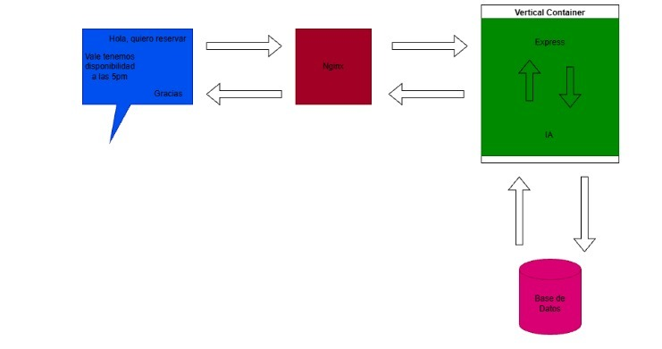
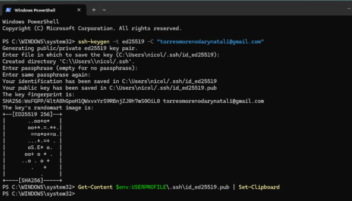
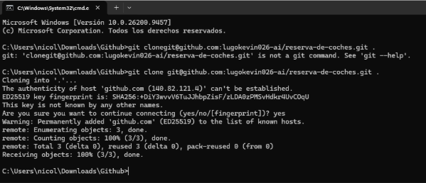
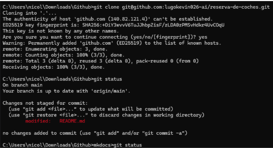

# KYNIC COMPANY


**Alquiler de coches por horas.** Elige fecha, hora y duración, y reserva en minutos con nuestro asistente virtual.

[Reservar ahora](#reserva) · [Hablar con el asistente](#asistente)

**1–8 h** de alquiler · **24 h** asistente disponible · **0** solapes de reservas

## Presentación del negocio { #negocio }

**Nombre de la empresa:** KYNIC Company

**Tipo de negocio:** alquiler de coches

### El problema que resolvemos

Gestionar reservas de coches de forma rápida y organizada es difícil. El cliente necesita saber qué vehículos están libres, elegir la fecha y la hora de recogida y decidir durante cuánto tiempo usará el coche. Además, hay problemas cuando quiere modificar la reserva y no se comprueba bien la disponibilidad.

Por eso creamos un sistema de reservas con un asistente virtual.

### Cómo funciona

1. El cliente entra al chat y el asistente le pregunta cuándo desea la reserva, la hora de recogida y por cuánto tiempo.
2. Le mostramos la lista de coches disponibles.
3. El cliente confirma la reserva y realiza el pago.

**Ejemplo de reserva:**

| Cliente | Fecha | Hora | Duración | Coche | Correo | Teléfono |
|---|---|---|---|---|---|---|
| Carlos | 29/09/2026 | 10:00 | 4 horas | Ford Fiesta | juan@gmail.com | 600000000 |



*Recorrido de los datos de una reserva.*

## Nuestra flota { #flota }

Una muestra de los coches que se pueden reservar. El asistente dice cuáles están libres en la fecha y hora elegidas.

| Coche | Descripción | Plazas | Precio |
|---|---|---|---|
| **Ford Fiesta** | Urbano y económico | 5 | 8 € / hora |
| **Seat León** | Compacto cómodo para carretera | 5 | 11 € / hora |
| **Toyota C-HR** | SUV híbrido, bajo consumo | 5 | 14 € / hora |
| **Mercedes Clase V** | Furgoneta premium para grupos | 7 | 22 € / hora |

*Modelos y precios ficticios, proyecto de clase.*

## Reserva un coche { #reserva }

La reserva se hace con un formulario que pide estos datos:

| Dato | Detalle |
|---|---|
| **Nombre** | Entre 2 y 100 caracteres |
| **Fecha de recogida** | Día en que se recoge el coche |
| **Hora de recogida** | Hora de inicio del alquiler |
| **Horas de uso** | De 1 a 8 horas |

## Asistente virtual { #asistente }

El asistente atiende las 24 horas. Empieza con este saludo:

> **Asistente:** ¡Hola! Soy el asistente de KYNIC. ¿Qué día y a qué hora quieres recoger el coche, y por cuántas horas lo usarás?

Y así sería una conversación corta:

> **Cliente:** Hola, quiero reservar.
>
> **Asistente:** Vale, tenemos disponibilidad a las 5 pm.
>
> **Cliente:** Gracias.

## Condiciones { #condiciones }

- Puedes modificar la fecha y la hora de recogida, o cambiar de coche, según la disponibilidad.
- No se puede reservar un coche que ya está reservado.
- Si te pasas del día de entrega, se cobra una penalización de 30 a 40 €.
- Cualquier daño se cobra en el momento de la entrega.

*Datos ficticios, proyecto de clase.*

## Preguntas frecuentes { #faq }

??? question "¿Puedo cambiar la fecha o la hora?"
    Sí. Puedes modificar la recogida o cambiar de coche, siempre que haya disponibilidad.

??? question "¿Qué pasa si devuelvo el coche tarde?"
    Pasado el día de entrega se cobra una penalización de 30 a 40 €.

??? question "¿Cuándo se paga?"
    Después de confirmar la reserva con el asistente.

??? question "¿Y si el coche tiene daños?"
    Se cobran en el momento de la entrega.

## Equipo { #equipo }

Los tres miembros del equipo están en la página [Miembros](miembros.md): Kevin Alvarez, Nicoll Torres y Yankel Murcia.

## GitHub { #github }

**Vincular una carpeta del PC con un repositorio de GitHub**

GitHub es una plataforma que permite almacenar repositorios de Git en Internet y trabajar en equipo: se puede invitar a colaboradores, y cualquiera puede ver y descargar los repositorios públicos. Aquí trabajamos con el repositorio **reserva-de-coches** y una conexión mediante SSH.

!!! note "¿Qué es SSH?"
    SSH en GitHub sirve para conectarnos al repositorio de forma segura sin escribir la contraseña cada vez.

### 1. Crear una clave SSH

En el ordenador creamos una clave y la añadimos a la cuenta de GitHub. Después podemos clonar, subir y descargar proyectos con SSH de forma rápida y sencilla.





### 2. Crear el archivo README.md

```bash
echo "# reserva-de-coches" >> README.md
```

Este comando crea un archivo llamado `README.md` y escribe dentro el texto `# reserva-de-coches`. El README se usa para explicar de qué trata un proyecto. El símbolo `>>` añade texto al archivo y, si no existe, lo crea.



### 3. Inicializar Git en la carpeta

```bash
git init
```

Convierte la carpeta actual en un repositorio local. Se crea la carpeta oculta `.git`, donde Git guarda la información para controlar las versiones y los cambios.

### 4. Añadir los archivos al área de preparación

```bash
git add .
```

Añade todos los archivos de la carpeta al área de preparación (*staging area*), que sirve para elegir qué archivos entrarán en el siguiente commit.

### 5. Crear un commit

```bash
git commit -m "first commit"
```

Guarda los cambios de la staging area. Un commit es como una versión guardada del proyecto, y la opción `-m` permite escribir un mensaje que explique qué cambios hemos hecho.

### 6. Cambiar la rama a main

```bash
git branch -M main
```

Cambia el nombre de la rama actual a `main`, que normalmente es la rama principal del repositorio.

### 7. Vincular el repositorio local con GitHub

```bash
git remote add origin git@github.com:lugokevin026-ai/reserva-de-coches.git
```

Conecta el repositorio local con el de GitHub. `origin` es el nombre habitual del repositorio remoto principal, y la dirección SSH indica dónde está.

### 8. Subir los archivos a GitHub

```bash
git push -u origin main
```

Sube los commits a GitHub. `origin` es el repositorio remoto y `main` la rama. La opción `-u` guarda esa conexión como predeterminada, así que en los siguientes envíos basta con `git push`.

### 9. Proceso completo

Si tenemos una carpeta normal en el PC y queremos subirla al repositorio, primero entramos en ella desde la terminal y luego ejecutamos los comandos:

```bash
cd "C:\Users\Kevin\Desktop\reserva-de-coches"
git init
git add .
git commit -m "first commit"
git branch -M main
git remote add origin git@github.com:lugokevin026-ai/reserva-de-coches.git
git push -u origin main
```

Con esto convertimos la carpeta en un repositorio Git, guardamos los archivos con un commit, vinculamos el repositorio local con GitHub y subimos los archivos.

### 10. Si el repositorio local ya existe

Si la carpeta ya tiene Git y ya hay un commit, no hace falta repetir `git init`, `git add` ni `git commit`:

```bash
git remote add origin git@github.com:lugokevin026-ai/reserva-de-coches.git
git branch -M main
git push -u origin main
```

Es la segunda opción que muestra GitHub, *"…or push an existing repository from the command line"*: trabajamos con un repositorio local que ya existe y solo hay que conectarlo con GitHub y subirlo.

### Subir nuevos cambios

Una vez vinculado el repositorio, cada vez que cambiemos archivos usamos:

```bash
git add .
git commit -m "descripción del cambio"
git push
```

- `git add` añade los cambios a la staging area.
- `git commit` los guarda en el repositorio local.
- `git push` los sube a GitHub.

En resumen: **carpeta del PC** → `git init` → `git add .` → `git commit` → `git branch -M main` → `git remote add origin` → `git push` → **repositorio de GitHub**. Así la carpeta queda vinculada con el repositorio «reserva-de-coches».
